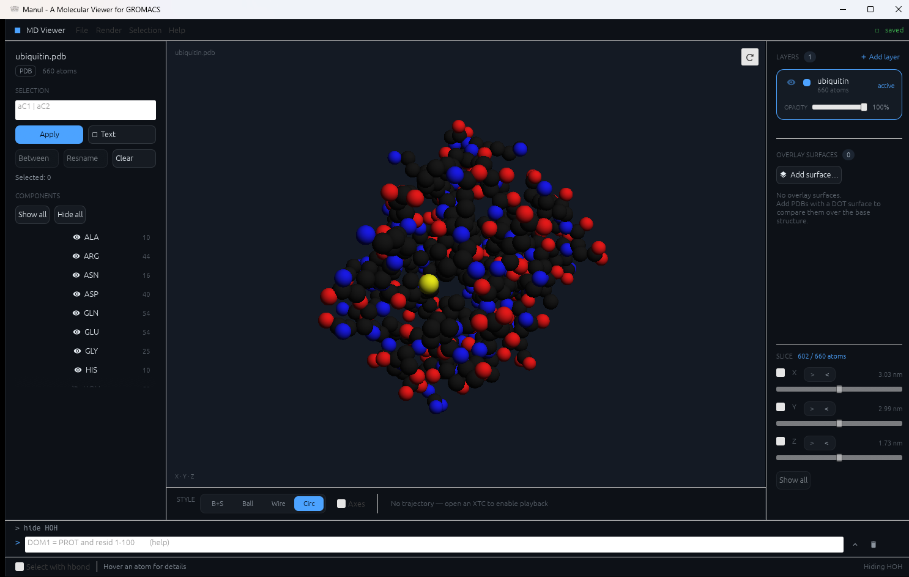
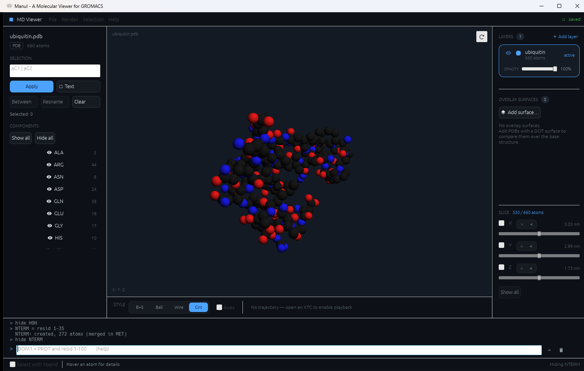
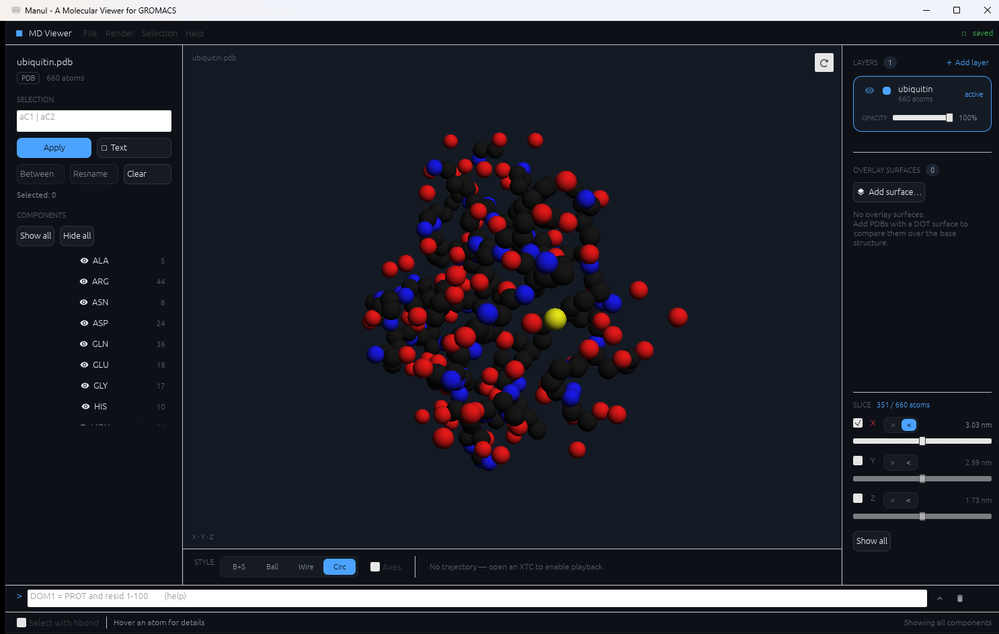
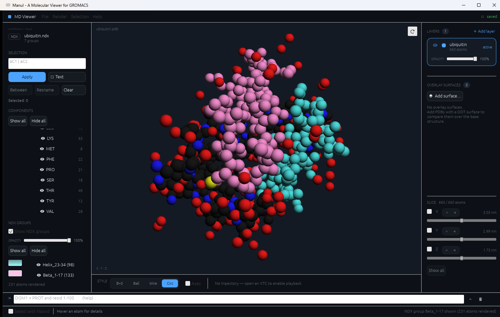

[日本語 README はこちら](README_ja.md)

# Manul — a molecular viewer for GROMACS

Manul is a desktop app for **looking at and checking GROMACS inputs and outputs**:
structures, topologies, index files, trajectories and PLUMED scripts. It started as
a way to see the intermolecular interactions defined in a `.top` file — so wrong or
inconsistent settings jump out before a run — and has grown into a general viewer
for MD structures, coarse-grained systems, surfaces and trajectories.



---

## Contents

* [Install](#install)
* [Quick start](#quick-start)
* [Controls](#controls)
* [Features](#features)
* [Component commands](#component-commands)
* [Supported files](#supported-files)
* [License](#license) · [Author](#author)

---

## Install

Download the file for your OS from the
[latest release](https://github.com/IndigoCarmine/manul_cat_rs/releases/latest):

| OS | File |
| --- | --- |
| Windows | `manul-setup-<version>-windows-x64.exe` (installer) or `manul-<version>-windows-x64.exe` (portable) |
| macOS | `manul-<version>-macos-universal.dmg` (Intel and Apple Silicon) |
| Linux | `manul-<version>-linux-x86_64.AppImage`, or `manul-cat-rs_<version>_amd64.deb` |

To build from source, install a Rust toolchain and run:

```sh
cargo run --release
```

---

## Quick start

1. **Open a file.** Drag it onto the window, use *File → Open Molecule* (**Ctrl+O**),
   or pass its path as a command-line argument. On Windows, *Open with → Manul* works too.
2. **Look around.** Drag to rotate, scroll to zoom (see [Controls](#controls)).
3. **Add more files** to the same view: a topology (*Open TOP*, **Ctrl+T**), an index
   file (*Import NDX*), a trajectory (*Open XTC*) or a PLUMED script (*Import PLUMED*).
   They are all checked against the structure that is already loaded.
4. **Hide what is in the way.** Every residue name starts as its own *component*;
   toggle them in the left panel, or type commands such as `hide SOL` into the command
   bar at the bottom (**Ctrl+P**).

> You can also drop (or pass) several files at once, e.g. `topol.top conf.gro index.ndx
> traj.xtc`. They load in dependency order: the structure first, then the index file,
> then the trajectory. Extra structure files open as new layers. Only one file of each
> other kind is used per drop; any left over are named in the status bar.

---

## Controls

### 3D view

| Input | Action |
| --- | --- |
| Left drag | Rotate |
| Shift + left drag, or right/middle drag | Pan |
| Mouse wheel | Zoom |
| Click an atom | Select it (its name and residue are shown in the status bar on hover) |
| ⟳ button (top right of the view) | Reset view |

### Fly mode (first-person navigation)

Press **F** with the pointer over the view to fly through the system like in a game.
Useful for looking around inside a solvated box or a membrane.

| Input | Action |
| --- | --- |
| **F** | Enter / leave fly mode (the cursor is hidden and held in the view) |
| Move the mouse (no click) | Look around |
| **W / A / S / D** | Move forward / left / back / right |
| **Space** (or **Enter**) | Move up |
| **Shift + Space** | Move down |
| **Esc** | Back to the normal rotate/zoom controls |

Movement speed scales with the size of the system.

### Keyboard shortcuts

| Shortcut | Action |
| --- | --- |
| Ctrl+O | Open a structure |
| Ctrl+T / Ctrl+G | Open a topology / a `.gro` file |
| Ctrl+Shift+O | Open a `.top` + `.gro` pair |
| Ctrl+P | Focus the command bar |
| Ctrl+S | Export the (edited) structure |
| Ctrl+E | Export an image |
| Ctrl+R | Edit residue names |
| Ctrl+H | Toggle H-bond-aware selection |
| Ctrl+B | Select the shortest path between the two selected atoms |
| Ctrl+Shift+A | Clear the selection |
| ↑ / ↓ | Step through PLUMED lines (PLUMED tab) |

---

## Features

### Viewing

* **Render styles** — ball + stick, ball, wireframe and circles (fast sphere impostors,
  the default; scales to millions of atoms). Switch them at the bottom of the view.
* **Components** — named, show/hide-able groups of atoms. They start as one per
  residue name and can be split and merged from the command bar
  ([Component commands](#component-commands)).

  

  *`NTERM = resid 1-35` then `hide NTERM`: residues 1–35 are moved into a new
  component and hidden.*

* **XYZ slice** — a cut plane per world axis with a slider (right panel, bottom). Tick
  an axis and only the atoms on the chosen side of the plane are drawn; combine axes
  to peel off a face or a corner of a solvated box and look at the core. The cut also
  applies to image/video export and overlay layers, and it stays fixed in space while a
  trajectory plays. It only affects the view — structure export always writes every atom.

  

* **Document layers** — load several structures at once to compare them. Each layer has
  its own visibility, identity colour and opacity.
* **Surfaces** — dot surfaces from `gmx sasa` PDBs, plus any number of **overlay
  surfaces** from separate files, each with its own colour.
* **Coarse-grained systems** — Martini beads are sized from the force field's LJ sigma
  and coloured by bead type. For any other CG model, *File → Import Particle Radii (CSV)*
  (or drop a `.csv`) reads `name,radius` rows (radius in nm; matched by atom name, then
  topology atom type). Toggle with *Custom radii* in the bottom bar.
* **Opacity** per molecule and per layer.

### Checking GROMACS inputs

* **Topology** (`.top` / `.itp`, with `#include` expansion) — visualizes the
  **intermolecular interactions** it defines and cross-checks the topology against the
  `.gro` / `.pdb` structure.
* **Index groups** (`.ndx`) — every group gets a colour and a visibility toggle, with its
  own opacity separate from the structure's. Selections can be turned into selection
  strings for `make_ndx`.

  

* **PLUMED scripts** (`plumed.dat`) — the left panel gains a PLUMED tab listing the
  script with syntax colouring. Step through it with ↑/↓ or Prev/Next, and the current
  line lights up in the 3D view: its atoms are haloed, virtual atoms (`CENTER` / `COM`)
  get a marker sphere, and the vectors a collective variable measures are drawn as
  arrows. A bias or function is followed through its `ARG=` to the CVs it reads. An atom
  number the structure does not have is reported as an error on that line instead of
  being dropped silently — exactly the kind of mistake the view is there to catch. The
  file is never written.

### Trajectories and export

* **XTC playback** — play / step / seek, adjustable FPS, and frame interpolation
  (smoothing) between recorded frames.
* **Image export** — *File → Export Image…* (**Ctrl+E**), with a transparent background
  option and supersampling.
* **Video export** — renders the trajectory to MP4 by writing a PNG sequence and handing
  it to an `ffmpeg` on your machine (none is bundled). Without one the frames are still
  written; on Windows the app can install it through `winget` after showing you the
  exact command, and elsewhere it points you at `apt` / `dnf` / `flatpak` / `brew`.

### Selecting and editing

* **Atom selection** — click atoms in the view, selector expressions (e.g. `aC1 | aC2`),
  shortest-path *Between*, and H-bond-aware selection.
* **Residue-name editing**, and export of the edited structure.
* **Loaded files** are listed in the left panel, so you can always see what is open.

---

## Component commands

Press **Ctrl+P** to focus the command bar at the bottom of the window, then type `help`
for this reference in-app. Components are a *display* grouping: splitting and merging
never touches your PDB / GRO / TOP files.

Every atom belongs to exactly one component, so assignment **moves** atoms — which is
what makes splitting and merging the same operation:

```
DOM1 = PROT and resid 1-100        # split: those atoms leave PROT for DOM1
PROT = PROA or PROB or PROC        # merge: the three sources empty out and vanish
```

| Command | Meaning |
| --- | --- |
| `NAME = <selection>` | move every matched atom into `NAME` (creating it if new) |
| `<selection>` | report how many atoms match, changing nothing |
| `show NAME...` / `hide NAME...` | show or hide components; `show all` / `hide all` for the lot |
| `only NAME` | show `NAME`, hide everything else |
| `del NAME...` | dissolve: the atoms fall back to their residue-name components |
| `rename OLD NEW`, `list`, `reset`, `help` | |

Selections:

| Term | Matches |
| --- | --- |
| `resname SOL NA` | residue names |
| `resid 1-100 205` | residue numbers; several numbers and ranges allowed |
| `index 1-4000` | atom numbers, 1-based, as in a `.ndx` file |
| `name CA C1'` / `element C O` | atom names / element symbols |
| `selected` | the atoms currently picked in the view |
| `all`, `none` | |
| `sp`, `sp2`, `sp3` | hybridisation, inferred from the number of bonds |
| `numbonds 4` | bond count; also `>=N`, `<=N`, `>N`, `<N`, `N-M` |
| `with 2 H` | exactly 2 bonded hydrogens; takes the same count forms |
| `and`, `or`, `not` | also `&`, `\|`, `!`; precedence is `not` > `and` > `or` |
| `( )`, `"NAME"` | grouping; quote a name that collides with a keyword |

```
CH2  = element C and sp3 and with 2 H          # methylene carbons
CH3  = element C and sp3 and with 3 H          # methyl carbons
QUAT = element C and numbonds 4 and with 0 H   # quaternary carbons
SITE = selected                                # freeze the current pick
```

Two things worth knowing:

* A bare word resolves in this order — **component, residue name, element, atom name** —
  and every resolution is echoed in the log. The order matters for real collisions: the
  DNA residue `C` (cytosine) wins over carbon, so write `element C` when you mean the
  element.
* `sp`/`sp2`/`sp3`, `numbonds` and `with` read the bond graph, which only comes from a
  `.top`, a PDB `CONECT` record or a MOL2 file. On a bare `.gro` they report that there
  is no topology rather than silently matching nothing. Hybridisation is inferred from
  coordination number, so an amide nitrogen (three neighbours) reads as `sp3`.

---

## Supported files

| Extension | Contents |
| --- | --- |
| `.gro` | coordinates / structure |
| `.pdb` | coordinates / structure, including `gmx sasa` dot surfaces |
| `.mol2` | coordinates / structure |
| `.top` / `.itp` | topology (GROMACS `#include` expansion supported) |
| `.ndx` | index groups |
| `.xtc` | trajectory |
| `.dat` | PLUMED input (read-only inspection) |
| `.csv` | per-particle radii (`name,radius`, nm) |

---

## License

GNU Affero General Public License v3.0 or later (AGPL-3.0-or-later).
See [LICENSE](LICENSE) for the full text.

Screenshots show ubiquitin, [PDB 1UBQ](https://www.rcsb.org/structure/1UBQ).

---

## Author

Yuhei Yamada (Indigo Carmine)
ORCID: [0009-0003-9780-4135](https://orcid.org/0009-0003-9780-4135)
