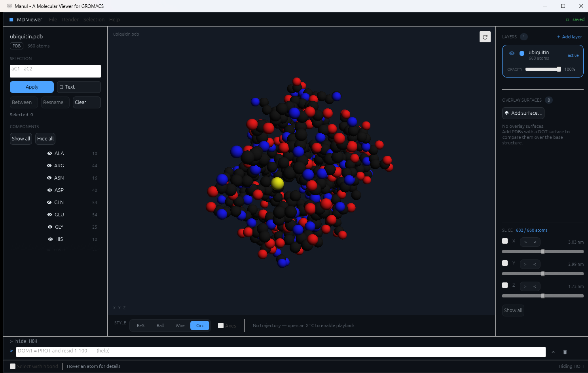
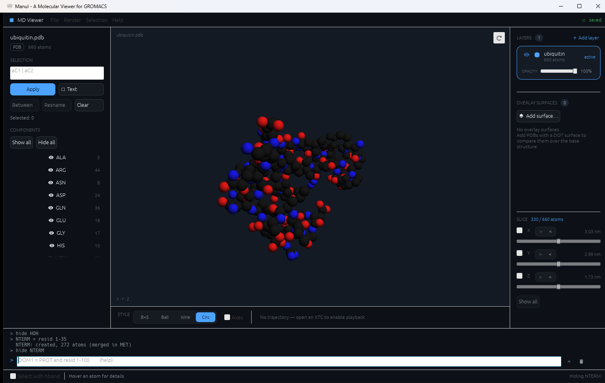
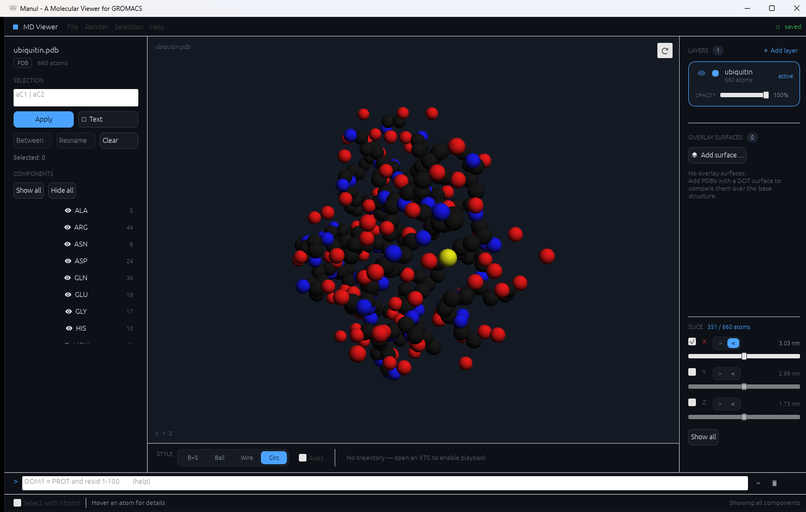
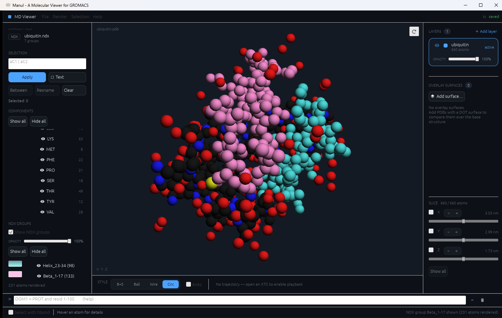

[English README](README.md)

# Manul — GROMACS 向け分子ビューア

Manul は、GROMACS の入出力（構造・トポロジー・インデックス・トラジェクトリ・
PLUMED スクリプト）を**見て確かめる**ためのデスクトップアプリです。
もともとは `.top` に定義した intermolecular interaction を目で確認し、設定ミスや
不整合を計算前に見つけるためのツールでしたが、現在は MD 構造・粗視化系・表面・
トラジェクトリを扱う汎用ビューアに広がっています。



---

## 目次

* [インストール](#インストール)
* [はじめかた](#はじめかた)
* [操作方法](#操作方法)
* [機能](#機能)
* [コンポーネントコマンド](#コンポーネントコマンド)
* [対応ファイル](#対応ファイル)
* [ライセンス](#ライセンス) · [Author](#author)

---

## インストール

[最新リリース](https://github.com/IndigoCarmine/manul_cat_rs/releases/latest) から
OS に合ったファイルをダウンロードしてください。

| OS | ファイル |
| --- | --- |
| Windows | `manul-setup-<version>-windows-x64.exe`（インストーラ）または `manul-<version>-windows-x64.exe`（ポータブル） |
| macOS | `manul-<version>-macos-universal.dmg`（Intel / Apple Silicon 両対応） |
| Linux | `manul-<version>-linux-x86_64.AppImage` または `manul-cat-rs_<version>_amd64.deb` |

ソースからビルドする場合は、Rust ツールチェーンを入れて次を実行します。

```sh
cargo run --release
```

---

## はじめかた

1. **ファイルを開く。** ウィンドウにドラッグ＆ドロップするか、*File → Open Molecule*
   （**Ctrl+O**）、またはコマンドライン引数でパスを渡します。Windows では
   「プログラムから開く → Manul」も使えます。
2. **見回す。** ドラッグで回転、ホイールでズーム（[操作方法](#操作方法)）。
3. **同じビューにファイルを足す。** トポロジー（*Open TOP*、**Ctrl+T**）、インデックス
   （*Import NDX*）、トラジェクトリ（*Open XTC*）、PLUMED スクリプト（*Import PLUMED*）。
   どれも読み込み済みの構造と照合されます。
4. **邪魔なものを隠す。** 残基名ごとに*コンポーネント*ができているので、左パネルで
   切り替えるか、下部のコマンドバー（**Ctrl+P**）に `hide SOL` のように入力します。

> ファイルは 1 つずつ読み込んでください。複数ファイルを一度にドロップ・引数指定すると、
> 読み込まれるのはそのうち 1 つだけです。例外は `.top` と `.gro` の組、および構造と
> 一緒にドロップした PLUMED スクリプトや半径 `.csv` です。

---

## 操作方法

### 3D ビュー

| 入力 | 動作 |
| --- | --- |
| 左ドラッグ | 回転 |
| Shift + 左ドラッグ、または右・中ドラッグ | 平行移動 |
| マウスホイール | ズーム |
| 原子をクリック | 選択（ポインタを乗せると原子名・残基名が下部に表示） |
| ⟳ ボタン（ビュー右上） | 視点をリセット |

### フライモード（一人称移動）

ビュー上にポインタを置いて **F** を押すと、ゲームのように系の中を飛び回れます。
溶媒和ボックスや膜の内部を見回すときに便利です。

| 入力 | 動作 |
| --- | --- |
| **F** | フライモードの開始 / 終了（カーソルは非表示になりビュー内に固定） |
| マウスを動かす（クリック不要） | 視点を回す |
| **W / A / S / D** | 前 / 左 / 後 / 右へ移動 |
| **Space**（または **Enter**） | 上昇 |
| **Shift + Space** | 下降 |
| **Esc** | 通常の回転・ズーム操作に戻る |

移動速度は系の大きさに合わせて自動で決まります。

### キーボードショートカット

| ショートカット | 動作 |
| --- | --- |
| Ctrl+O | 構造ファイルを開く |
| Ctrl+T / Ctrl+G | トポロジー / `.gro` を開く |
| Ctrl+Shift+O | `.top` と `.gro` を組で開く |
| Ctrl+P | コマンドバーにフォーカス |
| Ctrl+S | （編集した）構造を書き出す |
| Ctrl+E | 画像を書き出す |
| Ctrl+R | 残基名の編集 |
| Ctrl+H | 水素結合を考慮した選択の切り替え |
| Ctrl+B | 選択中の 2 原子間の最短経路を選択 |
| Ctrl+Shift+A | 選択を解除 |
| ↑ / ↓ | PLUMED の行を送る（PLUMED タブ） |

---

## 機能

### 表示

* **描画スタイル** — ball + stick / ball / wireframe / circles（高速な球インポスター。
  既定で、数百万原子まで扱える）。ビュー下部で切り替えます。
* **コンポーネント** — 表示/非表示を切り替えられる名前付きの原子グループ。初期状態は
  残基名ごとに 1 つで、コマンドバーから分割・結合できます
  （[コンポーネントコマンド](#コンポーネントコマンド)）。

  

  *`NTERM = resid 1-35` → `hide NTERM`：残基 1–35 を新しいコンポーネントに移して隠す。*

* **XYZ スライス** — 右パネル下部に、軸ごとの切断面スライダがあります。軸を有効にすると、
  面のどちら側にあるかで原子の表示が決まります。三軸を組み合わせれば、溶媒和ボックスの
  面や角を削って中心部を覗けます。切断は画像・動画の書き出しやオーバーレイにも反映され、
  トラジェクトリ再生中も面は空間に固定されたままです。表示上の状態なので、構造の
  書き出しは常に全原子です。

  

* **ドキュメントレイヤー** — 複数の構造を同時に読み込んで比較できます。各レイヤーは
  表示・識別色・不透明度を個別に持ちます。
* **表面** — `gmx sasa` の PDB からドット表面を表示。別ファイルの**オーバーレイ表面**を
  色分けしていくつでも重ねられます。
* **粗視化系** — Martini ビーズは力場の LJ sigma から半径を、bead type から色を決めて
  表示します。それ以外の CG モデルは *File → Import Particle Radii (CSV)*（または `.csv`
  をドロップ）で `name,radius` 形式（半径は nm、原子名→トポロジーの atom type の順に照合）
  の表を読み込めます。下部バーの *Custom radii* で切り替え。
* **不透明度**を分子・レイヤーごとに調整。

### GROMACS 入力の確認

* **トポロジー**（`.top` / `.itp`、`#include` 展開対応）— 定義された
  **intermolecular interaction を可視化**し、`.gro` / `.pdb` の構造と突き合わせます。
* **インデックス group**（`.ndx`）— group ごとに色と表示切り替えがあり、不透明度も
  構造本体とは別に調整できます。`make_ndx` 用の選択文字列も生成できます。

  

* **PLUMED スクリプト**（`plumed.dat`）— 開くと左パネルに PLUMED タブが増え、
  スクリプトがシンタックスハイライト付きで並びます。↑/↓ または Prev/Next で行を送ると、
  その行が 3D ビューに現れます。対象原子はハロー表示、仮想原子（`CENTER` / `COM`）には
  マーカー球、CV が測るベクトルは矢印で描かれます。bias や関数は `ARG=` を辿って参照先の
  CV を表示します。構造に存在しない原子番号は黙って捨てず、その行のエラーとして示します
  — こうした設定ミスを見つけることがこの機能の目的です。ファイルへの書き込みは一切
  行いません。

### トラジェクトリと書き出し

* **XTC 再生** — 再生 / コマ送り / シーク、FPS 調整、フレーム間の補間（スムージング）。
* **画像書き出し** — *File → Export Image…*（**Ctrl+E**）。背景の透過とスーパー
  サンプリングに対応。
* **動画書き出し** — トラジェクトリを MP4 に書き出します。PNG 連番を描画して手元の
  `ffmpeg` に渡す方式で、エンコーダは同梱していません。`ffmpeg` が無くても連番は残ります。
  Windows では実行コマンドを提示した上で `winget` 経由の導入を代行でき、それ以外の OS
  では `apt` / `dnf` / `flatpak` / `brew` のコマンドを案内します。

### 選択と編集

* **原子選択** — ビュー上のクリック、セレクタ式（例: `aC1 | aC2`）、最短経路の
  *Between*、水素結合を考慮した選択。
* **残基名の編集**と、編集した構造の書き出し。
* **読み込み済みファイル**は左パネルに一覧表示されます。

---

## コンポーネントコマンド

**Ctrl+P** でウィンドウ下部のコマンドバーにフォーカスし、`help` と入力すると
アプリ内で構文を確認できます。コンポーネントは*表示上の*グループであり、分割・結合を
行っても PDB / GRO / TOP ファイルは一切書き換わりません。

各原子はちょうど 1 つのコンポーネントに属します。したがって代入は原子の
**所属替え**であり、これが分割と結合を同じ操作にしています。

```
DOM1 = PROT and resid 1-100        # 分割: 該当原子が PROT から DOM1 へ移る
PROT = PROA or PROB or PROC        # 結合: 3 つが空になって消える
```

| コマンド | 意味 |
| --- | --- |
| `NAME = <選択式>` | マッチした原子を `NAME` へ移す（無ければ作成） |
| `<選択式>` | マッチ数を表示するだけ。状態は変えない |
| `show NAME...` / `hide NAME...` | 表示/非表示。`show all` / `hide all` で全体 |
| `only NAME` | `NAME` だけを表示し、他を全て隠す |
| `del NAME...` | 解体。原子は残基名由来のコンポーネントへ戻る |
| `rename OLD NEW`, `list`, `reset`, `help` | |

選択式:

| 要素 | 対象 |
| --- | --- |
| `resname SOL NA` | 残基名 |
| `resid 1-100 205` | 残基番号。複数の数値・範囲を並べられる |
| `index 1-4000` | 原子番号（1 始まり、`.ndx` と同じ） |
| `name CA C1'` / `element C O` | 原子名 / 元素記号 |
| `selected` | 現在ビュー上で選択している原子 |
| `all`, `none` | |
| `sp`, `sp2`, `sp3` | 混成軌道。結合本数から推定 |
| `numbonds 4` | 結合本数。`>=N` `<=N` `>N` `<N` `N-M` も可 |
| `with 2 H` | 隣接水素がちょうど 2 個。カウント指定は上と同じ |
| `and`, `or`, `not` | `&` `\|` `!` でも可。優先順位は `not` > `and` > `or` |
| `( )`, `"NAME"` | 括弧によるグループ化 / 予約語と衝突する名前の引用 |

```
CH2  = element C and sp3 and with 2 H          # メチレン炭素
CH3  = element C and sp3 and with 3 H          # メチル炭素
QUAT = element C and numbonds 4 and with 0 H   # 四級炭素
SITE = selected                                # 現在の選択を切り出す
```

注意すべき点が 2 つあります。

* キーワードなしの語は **コンポーネント名 → 残基名 → 元素記号 → 原子名** の順に
  解決され、解決結果は必ずログに出ます。実際に衝突するのは DNA の残基名 `C`
  （シトシン）で、この順序では炭素より残基名が優先されます。全炭素が欲しい場合は
  `element C` と書いてください。
* `sp`/`sp2`/`sp3`、`numbonds`、`with` は結合情報を参照します。結合は `.top`、
  PDB の `CONECT`、MOL2 からしか得られないため、素の `.gro` では 0 件を返さずに
  「トポロジーが無い」旨のエラーになります。混成軌道は結合本数からの推定なので、
  アミド窒素（隣接 3 本）は `sp3` と判定されます。

---

## 対応ファイル

| 拡張子 | 内容 |
| --- | --- |
| `.gro` | 座標 / 構造 |
| `.pdb` | 座標 / 構造（`gmx sasa` のドット表面を含む） |
| `.mol2` | 座標 / 構造 |
| `.top` / `.itp` | トポロジー（GROMACS の `#include` 展開に対応） |
| `.ndx` | インデックス group |
| `.xtc` | トラジェクトリ |
| `.dat` | PLUMED 入力（閲覧専用） |
| `.csv` | 粒子ごとの半径（`name,radius`、nm） |

---

## ライセンス

GNU Affero General Public License v3.0 以降 (AGPL-3.0-or-later)。
全文は [LICENSE](LICENSE) を参照してください。

スクリーンショットの分子はユビキチン [PDB 1UBQ](https://www.rcsb.org/structure/1UBQ) です。

---

## Author

Yuhei Yamada (Indigo Carmine)
ORCID: [0009-0003-9780-4135](https://orcid.org/0009-0003-9780-4135)
